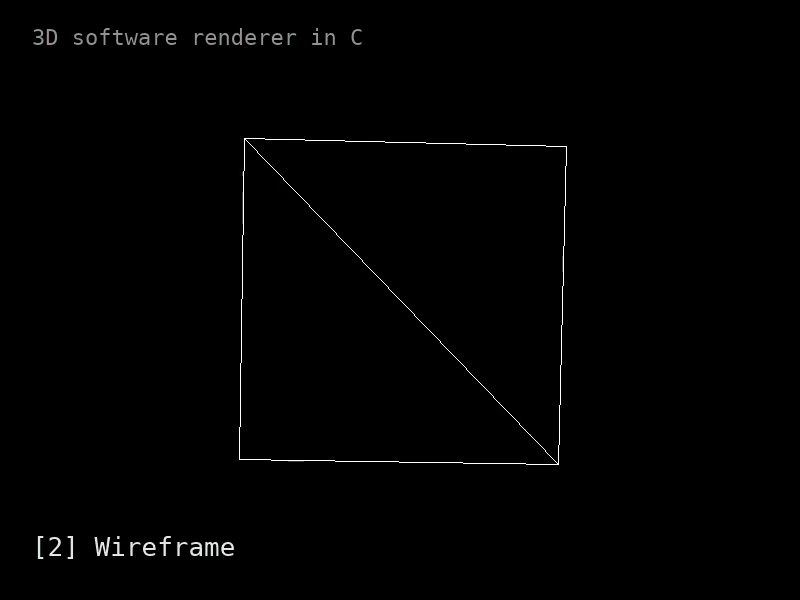

# 3D Renderer

A 3D software renderer written from scratch in C. No GPU and no graphics API: every pixel is calculated on the CPU and written into a buffer, and SDL2 is only used to put that buffer on the screen.

<p align="center">
  
</p>

## About

I wanted to understand what actually happens between "here's a list of 3D points" and "there's a cube on my screen", so I built the whole pipeline myself instead of letting OpenGL or a game engine do it. That meant writing my own vector maths, rotation, perspective projection, line drawing, triangle filling, backface culling and depth sorting, and seeing exactly where each piece fits.

## Features

- **Software rasterisation**: every pixel is drawn into a CPU colour buffer, SDL2 only displays it
- **Perspective projection**: points are divided by their depth so further things get smaller
- **3D rotation** around the X, Y and Z axes
- **Backface culling** using the face normal (cross product) and a dot product with the camera ray
- **Filled triangles** using the flat-top / flat-bottom split
- **Painter's algorithm**: triangles are sorted by average depth so far faces are drawn first
- **`.obj` loading** for external meshes (there's an F-22 model in `assets/`)
- **Live mode switching** for render and culling modes while it runs

## Controls

| Key   | Action                         |
|-------|--------------------------------|
| `1`   | Wireframe + vertices           |
| `2`   | Wireframe                      |
| `3`   | Filled faces                   |
| `4`   | Filled faces + wireframe       |
| `c`   | Backface culling on            |
| `d`   | Backface culling off           |
| `Esc` | Quit                           |

## Building and running

You need `gcc`, `make` and SDL2.

```bash
# Ubuntu / Debian
sudo apt install build-essential libsdl2-dev

git clone https://github.com/SamanAshoori/3drenderer.git
cd 3drenderer
make build
make run
```

The renderer opens fullscreen. Press `Esc` to quit.

## How it works

Every frame goes through the same pipeline:

1. **Mesh**: the model is a list of vertices (3D points) and faces. Each face is three vertex indices plus a colour.
2. **Transform**: each vertex is rotated around X, Y and Z using the rotation formulas (which come from the sine and cosine angle-addition identities), then pushed 5 units away from the camera so it's in front of it.
3. **Cull**: for each triangle I take two edge vectors, cross them to get the face normal, and dot that with the vector from the face to the camera. If the result is negative the face is pointing away, so it's skipped.
4. **Project**: perspective divide, `x' = fov * x / z` and `y' = fov * y / z`, then shift to the centre of the screen.
5. **Sort**: triangles are sorted by their average depth so the furthest are drawn first and nearer ones paint over them (painter's algorithm).
6. **Rasterise**: lines are drawn with the DDA algorithm. Filled triangles are split at the middle vertex into a flat-bottom and a flat-top triangle, which are each filled scanline by scanline.
7. **Present**: the colour buffer is copied into an SDL texture and shown, then cleared for the next frame.

## Project structure

```
src/
├── main.c       # setup, input, update and render loop
├── display.c/h  # window, colour buffer, drawing primitives (pixels, lines, rects)
├── triangle.c/h # triangle types and filled-triangle rasterisation
├── mesh.c/h     # cube mesh data and .obj loading
├── vector.c/h   # 2D/3D vector maths (rotation, cross, dot, normalise)
├── array.c/h    # dynamic array
└── sort.c       # radix sort experiment
assets/          # .obj models
```

## What I learned

- **Projection**: the difference between orthographic and perspective projection, and why dividing by z is all perspective really is
- **Coordinate systems**: left-handed vs right-handed coordinates, and how that changes the winding order and the direction of normals
- **Line drawing**: DDA vs Bresenham, and the trade-off between floating-point simplicity and integer-only speed
- **Linear algebra**: deriving the rotation formulas from the sine and cosine angle-addition proofs, and using cross and dot products for culling
- **Visibility**: backface culling and the painter's algorithm, and where the painter's algorithm breaks down (overlapping triangles that can't be sorted)
- **Sorting**: wrote a radix sort, then went with a simpler sort for the triangle list since it's small
- **C itself**: manual memory management, dynamic arrays and writing directly into a pixel buffer

## What's next

- Z-buffer to replace the painter's algorithm
- Flat shading with a light source
- Texture mapping
- Matrix transforms instead of separate rotate/translate functions
- A camera you can move around
- Per-face colours for `.obj` models

## Acknowledgements

<!-- TODO: credit the course, book or tutorial you followed -->
